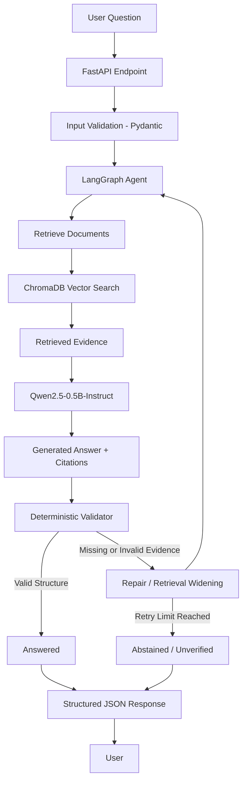

# 🛡️ EvidenceGuard

### A Self-Checking RAG Research Agent for Open-Source LLM Documentation

**EvidenceGuard** is a local, evidence-grounded research agent that answers questions about open-source LLMs using retrieved documentation. It generates numbered citations, validates answer structure, and uses bounded agentic workflows to repair unreliable responses or abstain when sufficient evidence is unavailable.

The project explores an important challenge in Retrieval-Augmented Generation (RAG): **retrieving the right information does not necessarily mean generating a correct, well-supported answer.**

It was designed to run locally on a CPU-only laptop with **8 GB RAM**, without depending on paid APIs or cloud-based LLM services.

---

## 🎯 Key Features

- **Local RAG Pipeline:** Document ingestion, heading-aware chunking, semantic embeddings, and vector search using ChromaDB.
- **Evidence-Based Generation:** Generates answers using retrieved passages with numbered evidence citations.
- **Deterministic Citation Validation:** Checks evidence IDs, missing citations, uncited sentences, copied headers, prompt echoes, and malformed responses.
- **Agentic Workflow:** Uses LangGraph to coordinate validation, bounded repair attempts, and retrieval widening.
- **Explicit Answer Status:** Returns `answered`, `abstained`, or `unverified` instead of automatically treating every generated response as reliable.
- **Reproducible Evaluation:** Measures retrieval performance and answer behavior through a gold-labeled benchmark.
- **FastAPI Service:** Exposes the agent through a REST API with structured JSON responses.
- **Automated Testing:** Includes 120+ automated tests using pytest, fakes, and dependency injection.

---

## 🏗️ System Architecture

EvidenceGuard follows a modular architecture that separates document retrieval, answer generation, validation, and agent orchestration.



---

## ⚙️ RAG Pipeline

### 1. Document Ingestion

The ingestion pipeline processes supported Markdown and text documents.

- Reads `.md` and `.txt` files.
- Extracts document headings and sections.
- Creates heading-aware chunks.
- Preserves source metadata for traceability.
- Skips unsupported, empty, or invalid UTF-8 files.

### 2. Embedding and Retrieval

- **Embedding Model:** Sentence-Transformers (MiniLM).
- **Vector Database:** ChromaDB.
- **Distance Metric:** Cosine similarity.
- **Retrieval:** Semantic search over indexed document chunks.

Retrieved passages retain their source metadata and are passed to the generation stage.

### 3. Answer Generation

**LLM:** Qwen2.5-0.5B-Instruct

The local language model receives the user's question and retrieved evidence, then attempts to generate an answer with numbered citations.

The model runs locally using PyTorch and Hugging Face Transformers.

### 4. Deterministic Citation Validation

A generated answer is not automatically considered trustworthy.

EvidenceGuard implements rule-based validation to detect:

- Invalid or unknown evidence IDs.
- Missing citations.
- Citation-only or empty answers.
- Uncited sentences.
- Copied evidence headers.
- Prompt-echo responses.

**Important:** Structural citation validation checks whether an answer follows the expected citation format. It does not independently prove that every cited passage semantically supports the corresponding claim.

### 5. Agentic Repair Workflow

LangGraph coordinates the decision-making process.

Depending on validation results, the agent can:

1. Accept a structurally valid response.
2. Attempt to repair a malformed answer.
3. Widen retrieval when additional evidence may help.
4. Stop after a bounded number of attempts.
5. Return an explicit status when the answer cannot be reliably produced.

This prevents unlimited retries and makes failure behavior observable.

---

## 📊 Evaluation and Results

The project includes a reproducible, gold-labeled evaluation benchmark covering:

- Answerable questions.
- Multi-section questions.
- Missing information.
- Ambiguous questions.
- Conflicting sources.
- Prompt-injection attempts using canary tokens.

### Retrieval Evaluation

The retrieval pipeline was evaluated on a small benchmark of 12 questions, with 9 answerable retrieval cases.

| Metric | Result |
| ------ | -----: |
| Hit\@1 |    8/9 |
| Hit\@3 |    9/9 |
| MRR    |   0.93 |

These results indicate strong retrieval performance on the tested answerable cases.

### End-to-End Evaluation

The initial baseline revealed an important limitation: despite successful retrieval, the 0.5B generator produced **zero correct, properly cited answers** in the baseline evaluation.

Further error analysis identified:

- A validator blind spot involving copied headers and repeated prompt text.
- A repair prompt that increased false abstentions from 4 to 7.
- Limitations in the small generator's ability to follow citation instructions reliably.

These findings were documented rather than hidden behind retrieval-only metrics.

**Main takeaway:** High retrieval accuracy does not guarantee reliable answer generation.

---

## 🧪 Testing and Code Quality

EvidenceGuard includes 120+ automated tests covering core functionality and failure scenarios.

Testing practices include:

- Unit and integration testing with pytest.
- Fake components and dependency injection.
- Validation of malformed model responses.
- Retrieval and citation edge cases.
- Agent workflow and retry behavior.
- Prompt-injection canary tests.
- Slow-test markers for tests requiring the real model.

Lazy imports reduced the fast test suite execution time from approximately **18 seconds to 5 seconds**.

---

## 🚀 API Service

The application exposes the research agent through FastAPI.

### API Capabilities

- Pydantic request validation.
- Structured JSON responses.
- Explicit answer status.
- Evidence and citation details.
- Validation issues.
- Latency information.
- Generic error responses that avoid exposing internal details.
- Serialized model inference using a lock.
- Environment-based configuration.

### Run the API

Start the development server:

```bash
uvicorn research_agent.api:app --reload
```

Access the interactive API documentation at:

```text
http://127.0.0.1:8000/docs
```

*The exact import path and endpoint details should match the current implementation.*

---

## 💻 Tech Stack

| Category            | Technologies                   |
| ------------------- | ------------------------------ |
| Language            | Python 3.11                    |
| Agent Orchestration | LangGraph                      |
| LLM                 | Qwen2.5-0.5B-Instruct          |
| Deep Learning       | PyTorch                        |
| LLM Framework       | Hugging Face Transformers      |
| Embeddings          | Sentence-Transformers (MiniLM) |
| Vector Database     | ChromaDB                       |
| API                 | FastAPI                        |
| Data Validation     | Pydantic                       |
| Testing             | Pytest                         |
| Version Control     | Git & GitHub                   |

---

## ⚡ Installation and Setup

### Prerequisites

- Python 3.11
- Git

### 1. Clone the repository

```bash
git clone https://github.com/SafaaRamadan/evidenceguard.git
cd evidenceguard
```

### 2. Create a virtual environment

```bash
python -m venv .venv
```

Activate it:

**Windows:**

```bash
.venv\Scripts\activate
```

**Linux / macOS:**

```bash
source .venv/bin/activate
```

### 3. Install dependencies

```bash
pip install -r requirements.txt
```

### 4. Configure environment variables

Use the provided `.env.example` as a reference if available.

### 5. Run the application

Start the API using the command described in the API section.

### 6. Run tests

```bash
pytest -q
```

For tests that require real model execution, use the appropriate slow-test marker configuration.

---

## 📁 Project Structure

```text
evidenceguard/
│
├── src/
│   └── research_agent/
│       ├── ingestion/
│       ├── retrieval/
│       ├── generator/
│       ├── validation/
│       ├── graph/
│       ├── evaluation/
│       └── api/
│
├── tests/
├── docs/
├── requirements.txt
├── pyproject.toml
├── .env.example
└── README.md
```

*The structure above illustrates the logical architecture; adjust directory names to match the actual repository.*

---

## 🔍 Engineering Challenges and Lessons Learned

Building EvidenceGuard involved more than connecting a vector database to an LLM.

Some of the most important engineering lessons were:

1. **Retrieval and generation are separate problems.** Good retrieval metrics can coexist with poor end-to-end answer quality.
2. **Validation needs adversarial testing.** A response can appear properly formatted while containing copied headers or prompt text.
3. **Retries are not always improvements.** Repair strategies can increase false abstentions instead of improving answer quality.
4. **Resource constraints influence architecture.** Local CPU inference requires careful model selection and dependency management.
5. **Reproducibility matters.** Recording model versions, precision, chunking settings, and prompt fingerprints makes evaluation results easier to compare.

---

## 🛣️ Future Improvements

- Evaluate stronger quantized local generators.
- Improve semantic claim-to-evidence verification.
- Expand the gold-labeled evaluation dataset.
- Compare retrieval and generation strategies.
- Improve repair prompts and abstention decisions.
- Add performance benchmarking across different hardware configurations.

---

*EvidenceGuard was developed as an independent AI engineering project to explore reliable RAG systems, agentic workflows, deterministic validation, and reproducible LLM evaluation.*
