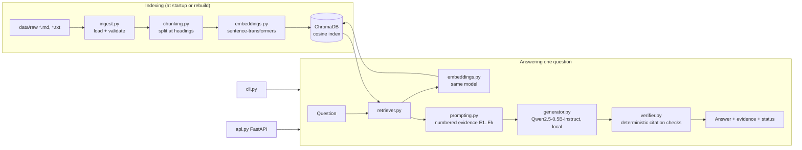
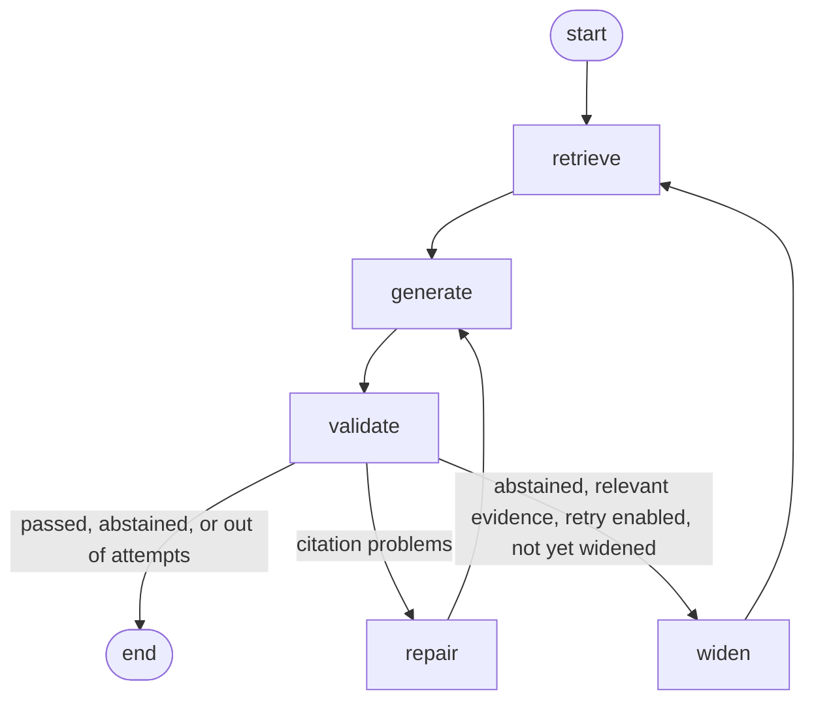

# EvidenceGuard architecture

## 1. Components

## 2. The agent graph (`agent.py`)

The straight-line pipeline (`pipeline.py`) is the baseline. The LangGraph agent adds two
bounded retry routes. Both are decided by deterministic checks, never by asking the same
LLM whether its answer is good.

(These edges match the graph LangGraph compiles; `EvidenceAgent.diagram()` prints the
generated version.)

| Route | Trigger (deterministic) | What changes | Cost |
|---|---|---|---|
| `repair` | validator reports `no_content`, `header_only`, `no_citations`, `invalid_citation`, `uncited_sentence` or `empty_answer` | the model sees its own answer plus a specific correction | one more generation |
| `widen` | the model abstained, `retry_on_abstain` is on, the best retrieval score is at least `min_retry_score`, and retrieval has not been widened yet | retrieval runs again with `widen_k` instead of `top_k` | one more retrieval and generation |

Every path is capped by `max_attempts` generations, so the loop always terminates.

Final statuses:

- `answered`: the answer passed the structural citation checks.
- `abstained`: the model replied with the exact abstention sentence.
- `unverified`: an answer exists but its citations failed the checks, even after repair.
  The API reports it as such instead of presenting it as verified.

## 3. What is deterministic and what is not

| Step | Kind | Notes |
|---|---|---|
| Loading, chunking, metadata | deterministic | unit tested |
| Embedding, retrieval | deterministic given the model and index | quality measured with Hit@k, Recall@k, MRR |
| Prompt construction | deterministic | retrieved text only ever goes in the user message |
| Generation | probabilistic model, greedy decoding | repeatable on one machine and precision, not guaranteed across them |
| Citation validation | deterministic | structural only (see below) |
| Abstention detection | deterministic | exact match on one fixed sentence |

## 4. What the verifier does and does not prove

`verifier.py` checks that cited IDs exist, that the answer has content besides citation tags,
and that every sentence carries a citation. It does **not** check that the cited passage
supports the sentence. `tests/test_verifier.py::test_passing_does_not_prove_the_claim_is_true`
documents this on purpose. A semantic check (for example a separate entailment model) would be
a different component with its own error rate, and would need its own evaluation.

## 5. Design decisions and alternatives

| Decision | Why | Alternative |
|---|---|---|
| Heading-based chunks with a `Title > Section` prefix | each chunk covers one topic and names its model | fixed-size windows (kept as a fallback for long sections) |
| Own vectors passed to ChromaDB | one embedding model for chunks and questions | letting Chroma embed (a different default model) |
| Gold labels as (file, section) pairs | stay valid when chunk IDs change | chunk IDs (fragile) |
| `rebuild()` instead of incremental updates | no stale chunks, simple at this size | `upsert` plus deletion logic |
| Plain pipeline before LangGraph | the graph must beat a baseline to justify its complexity | adopting a graph framework up front |
| One generation at a time (lock in the API) | one local model instance | worker processes or a queue |

## 6. Scaling notes (honest)

- The index is rebuilt at startup, which is fine for tens of documents, not for large corpora.
  Beyond that: incremental indexing, a persistent index, and ingestion as a separate job.
- Generation takes seconds per request on a CPU, and the API serializes requests. More users
  need more model replicas, a GPU or a hosted model, and a request queue.
- ChromaDB can serve far more chunks than this project has; the retrieval step is not the
  bottleneck here, generation is.